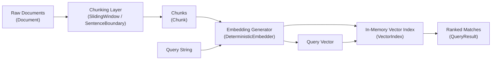
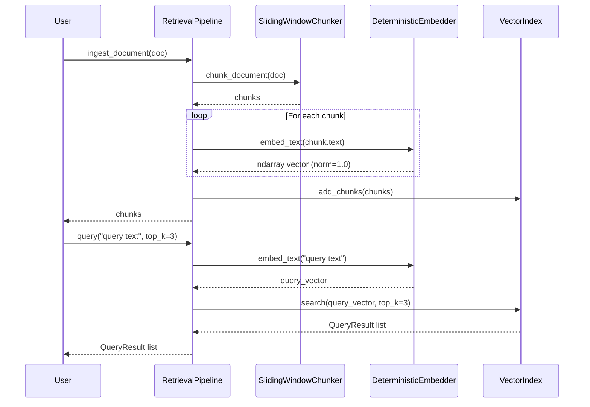

# ChunkFlow Architecture & System Design

## 1. System Overview

`chunkflow-core` is an in-memory, deterministic retrieval-augmented generation (RAG) pipeline engine built with Python and NumPy. It handles text ingestion, windowed and syntactic chunking, normalized dense vector embedding, and similarity search with metadata filtering.

### High-Level Topology

---

## 2. Core Subsystems & Interfaces

### 2.1 Domain Models (`src/chunkflow/models.py`)

The domain models provide the typed contracts passed through the pipeline stages:

- **`Document`**: The raw input container holding `doc_id: str`, `content: str`, and arbitrary dictionary `metadata: Dict[str, Any]`.
- **`Chunk`**: Represents an isolated segment of text generated from a document.
  - Inherits document metadata.
  - Tracks provenance via `chunk_id` (`{doc_id}#chunk_{n}`), `token_count`, `char_offset_start`, and `char_offset_end`.
  - Holds an optional dense vector (`embedding: Optional[np.ndarray]`).
- **`SearchFilter`**: A declarative key-value filter (`key: str`, `value: Any`) matched against chunk metadata tags.
- **`QueryResult`**: Represents a ranked match containing the matched `Chunk`, its cosine similarity `score: float`, and 1-based `rank: int`.

### 2.2 Chunking Engine (`src/chunkflow/chunker.py`)

Chunking decomposes continuous document text into discrete units with overlapping contexts:

- **`SlidingWindowChunker`**:
  - Operates on whitespace-tokenized words.
  - Configured by `chunk_size` (word capacity) and `chunk_overlap` (step size is `chunk_size - chunk_overlap`).
  - Computes approximate character offsets (`char_offset_start`, `char_offset_end`) for text tracing.
- **`SentenceBoundaryChunker`**:
  - Splits text along sentence boundaries using regex lookbehind (`(?<=[.!?])\s+`).
  - Aggregates full sentences into a single chunk until `max_words_per_chunk` is reached.
  - Prevents mid-sentence truncation.

### 2.3 Dense Vector Embedder & Metric Math (`src/chunkflow/embedder.py`)

- **`DeterministicEmbedder`**:
  - Generates reproducible, unit-normalized $D$-dimensional dense float vectors without downloading external model weights.
  - Cleans and hashes input text with SHA-256 to seed `np.random.default_rng(seed)`.
  - Normalizes output to unit Euclidean norm ($\|v\|_2 = 1.0$).
- **Similarity Metrics**:
  - `cosine_similarity(a, b)`: Computes $\frac{a \cdot b}{\|a\|_2 \|b\|_2}$ with guards against division by zero ($< 10^{-12}$).
  - `euclidean_distance(a, b)`: Computes $L_2$ norm $\|a - b\|_2$.

### 2.4 Vector Index (`src/chunkflow/index.py`)

- **`VectorIndex`**:
  - Pure in-memory vector storage holding indexed chunks.
  - Maintains `_doc_map: Dict[str, List[Chunk]]` for $O(1)$ lookups of chunks belonging to a document ID via `get_by_document(doc_id)`.
  - **Search Flow**:
    1. Filters candidate chunks matching all provided `SearchFilter` conditions.
    2. Computes cosine similarity between query vector and candidate chunk embeddings.
    3. Sorts candidates descending by similarity score.
    4. Truncates to `top_k` results and wraps into ranked `QueryResult` objects.

### 2.5 Retrieval Pipeline (`src/chunkflow/pipeline.py`)

- **`RetrievalPipeline`**:
  - Coordinates ingestion, chunking, embedding generation, index storage, and query execution.
  - Default parameters: `SlidingWindowChunker(100, 20)`, `DeterministicEmbedder(dimension=64)`, and `VectorIndex()`.
  - Provides `ingest_document(doc)`, `ingest_batch(docs)`, and `query(query_text, top_k, filters)`.

---

## 3. Data Flow & Lifecycle

---

## 4. Design Invariants & Guarantees

1. **Deterministic Reproducibility**: Given the same text string and embedder dimension, embedding vectors and similarity scores are deterministic across runs.
2. **Normalized Unit Vectors**: Embeddings produced by `DeterministicEmbedder` are unit vectors, ensuring dot products correlate directly with cosine similarity.
3. **Metadata Preservation**: Metadata applied at document ingestion is preserved across chunks, enabling filtered vector queries.
4. **Boundary Guarantees**: `SlidingWindowChunker` enforces `chunk_overlap < chunk_size` to guarantee forward progress without infinite loops.
