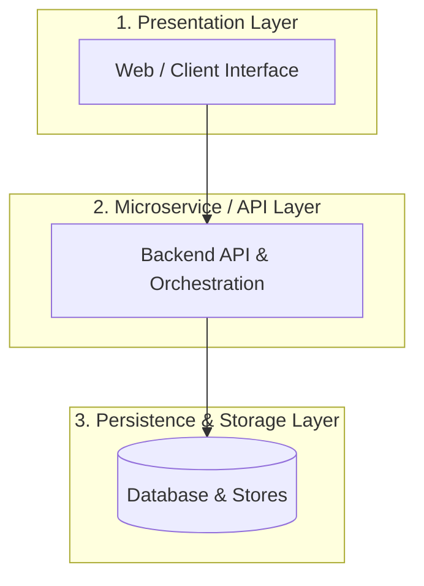

# Chunkflow Core Subsystems Documentation

Welcome to the subsystems architecture documentation for **Chunkflow Core**.

---

## 🗺️ Subsystem Architecture Map

The system is organized into decoupled layers and specialized services:

---

## 📁 Subsystem Dossiers

| Subsystem Document | Scope & Responsibilities |
| :--- | :--- |
| Core API & Services | High-level request lifecycle, routing, and domain service dispatch |
| Persistence & Data Model | Database schema design, migrations, relational integrity, and storage |
| Client / Frontend Architecture | UI component architecture, state management, and API clients |
